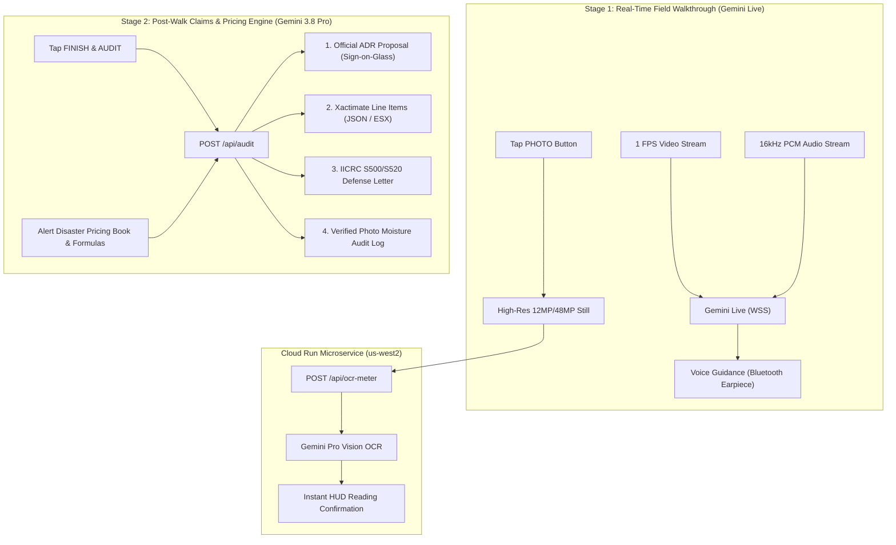

# Alert Disaster Restoration - Field Estimator & AI Claims Assistant

[](https://alert-disaster-live.web.app)
[](https://alert-disaster-field-estimator-219826144890.us-west2.run.app)
[](https://console.firebase.google.com/project/mitigation-project)
[](https://alertdisaster.com/)

A multimodal, dual-engine mobile web application and cloud microservice engineered for field technicians and sales estimators at **Alert Disaster Restoration** in Bakersfield, CA.

---

## 🚀 Live Environments

| Component | Target URL | Description |
| :--- | :--- | :--- |
| **Frontend Web App** | [https://alert-disaster-live.web.app](https://alert-disaster-live.web.app) | iPhone-optimized edge-to-edge web app with live camera, audio coaching, and document sign-on-glass. |
| **Backend Microservice** | [https://alert-disaster-field-estimator-219826144890.us-west2.run.app](https://alert-disaster-field-estimator-219826144890.us-west2.run.app) | FastAPI / Cloud Run backend running Gemini 3.8 / 2.5 Pro for high-res Extech meter OCR and claim synthesis. |
| **Health Check** | [https://alert-disaster-field-estimator-219826144890.us-west2.run.app/health](https://alert-disaster-field-estimator-219826144890.us-west2.run.app/health) | Microservice status, project attribution, and region validation. |

---

## 🏗️ Dual-Engine Architecture



### 1. Stage 1: Real-Time Multimodal Walkthrough (`gemini-live`)
- **Protocol**: Bidirectional WebSocket (`WSS`) streaming 16kHz PCM audio and 1 FPS camera video frames.
- **HUD Diagnostics**:
  - Live Extech MO290 moisture meter overlay (`99.9% SAT`, `Elevated`, `Dry Standard`).
  - FLIR thermal camera emulation mode (high-contrast gradient filter highlighting evaporative cooling differentials).
  - High-res photo capture pipeline with asynchronous background OCR.

### 2. Stage 2: Post-Walk Deep Audit & Document Generation (`gemini-3.8-pro`)
- **Protocol**: Cloud Run REST API (`/api/audit`) with structured JSON schema output.
- **Alert Disaster Pricing Book Engine**:
  - **Square Foot Demolition Rates**: Cat 1 Unfinished ($1.21/SF), Cat 1 Finished ($2.78/SF), Cat 2 Unfinished ($1.52/SF), Cat 2 Finished ($2.89/SF), Cat 3/Mold Unfinished ($2.48/SF), Cat 3/Mold Finished ($8.39/SF).
  - **Fixed Job Baseline Charges**: $1,180.20 total (Emergency Call $133.95, Monitoring 13.25 hrs $628.85, Haul Debris $159.53, Air Scrubber $74.75, HEPA Filter $183.12).
  - **Equipment Rates**: Air Movers ($29.25/day), Commercial LGR Dehumidifiers ($101.25/day) = $567.00 for standard S500 3-day drying run.
  - **Labor Rates**: Regular ($47.46/hr) vs. After-Hours ($83.45/hr).
- **Four Dedicated Post-Walk Tabs**:
  1. **Official ADR Remediation Proposal**: Alert letterhead, Matthew Myers authorization, California pre-1978 lead/asbestos notices, and e-signature pad.
  2. **Xactimate Scope**: Code list (`WTRDRY`, `WTRRMV`, `WTRDHM`, `WTRDRYM`, `APPANTI`), unit pricing, waste factor adjustments, and clipboard export.
  3. **IICRC Claim Defense Letter**: Formal adjuster report citing IICRC S500 §12.2.3, §13.5.4, and S520 §14.4.
  4. **Photo Moisture Audit Log**: Timestamped photo gallery with OCR-verified moisture readings.

---

## 📁 Repository Structure

```
charming-volta/
├── AGENTS.md                  # Autonomous agent guidelines & domain rules
├── README.md                  # System documentation & deployment guide
├── firebase.json              # Firebase Hosting configuration (target: alert-disaster)
├── .firebaserc                # Firebase project targets mapping (mitigation-project)
├── index.html                 # Root mirror of frontend application
├── public/                    # Production static build directory
│   ├── index.html             # Main single-page web app with dual-engine UI
│   └── ar_preview.jpg         # AR inspection preview fallback asset
└── backend/                   # Cloud Run microservice
    ├── Dockerfile             # Container definition for Cloud Run
    ├── main.py                # FastAPI endpoints (/api/ocr-meter, /api/audit)
    └── requirements.txt       # Python dependencies (fastapi, uvicorn, google-genai)
```

---

## 🛠️ Local Development & Deployment

### 1. Run Backend Locally
```bash
cd backend
python -m venv venv
venv\Scripts\activate
pip install -r requirements.txt
uvicorn main:app --reload --port 8080
```

### 2. Deploy Backend to Google Cloud Run
```bash
gcloud run deploy alert-disaster-field-estimator \
  --source ./backend \
  --region us-west2 \
  --project mitigation-project \
  --allow-unauthenticated
```

### 3. Deploy Frontend to Firebase Hosting
```bash
# Copy latest frontend code into public/ if modified
Copy-Item "public/index.html" -Destination "index.html" -Force

# Deploy only the alert-disaster target to avoid overwriting peer sites
firebase deploy --only hosting:alert-disaster --project mitigation-project
```

---

## 🎨 Branding & Visual Tokens
Extracted from [Alert Disaster Restoration](https://alertdisaster.com/):
- **Primary Red**: `#D42B32` (Emergency Call to Action)
- **Charcoal / Primary Dark**: `#010101` (Headings and text)
- **Neutral Background**: `#FFFFFE` / Off-white `#F1F2F2`
- **Border Gray**: `#E0E0E0`
- **Typography**: `Lato` (Sans-serif UI) & `EB Garamond` (Editorial prose)
- **Credentials**: California License `#950983`, EPA Lead-Safe Certified, IICRC Certified Firm.
